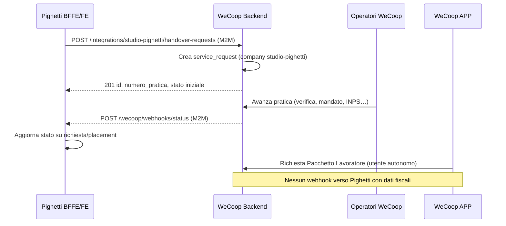

# Analisi tecnica — Integrazione Studio Pighetti × WeCoop

**Versione:** 0.1 (analisi interna)  
**Data:** 29 ottobre 2026  
**Autore:** Anthony / AYNIX (Cloud Agent)  
**Fonti:** email Lizandro Vivanco; *Documento Operativo Interno WECOOP × Studio Pighetti v0.2*; *Flusso di lavoro Recruiting Studio Pighetti* (12 ott 2026); codebase `studiopighetti-*`, `wecoop-backend`, `wecoop-frontend`, `wecoop-app`, riferimento integrazione `latinos-italia-bffe`.

**Scopo:** valutare fattibilità, gap e roadmap per collegare il gestionale Pighetti (MVP) alla piattaforma WeCoop, senza duplicare anagrafiche né esporre dati riservati del lavoratore a Pighetti.

---

## 1. Sintesi esecutiva

L’**MVP del gestionale Studio Pighetti** copre in modo solido i **12 passaggi AS-IS** del flusso Max (da presa in carico famiglia fino a colloquio/prova e **placement**). Manca ancora un evento operativo esplicito per **«scelta definitiva / esito prova positivo»** e **non esiste alcun modulo WeCoop** (né API né UI).

Su **WeCoop** esiste già un **pattern di integrazione partner** collaudato con **Latinos En Italia**: API M2M per creare `service_requests`, attribuzione a `company_id`, sync stati via **webhook outbound**, ruolo `operatore_esterno` e **scrub commerciale** dei dati sensibili. È il modello architetturale da replicare per Pighetti, con payload e stati ad hoc per il **Pacchetto Famiglia** e visibilità limitata.

Il **Portale Partner** WeCoop (frontend Angular) è orientato oggi a scenari fiscal/forfettario demo; per Pighetti serve soprattutto una **vista stato pratica** (in gestionale Pighetti o portale semplificato), non l’intero fascicolo CAF.

**Avvio indicativo gen–feb 2027:** fattibile se entro **novembre–dicembre 2026** si chiudono decisioni su post-prova, DPA/consensi e mapping stati; lo **sviluppo MVP integrazione** è stimato nell’ordine di **~25–35 giornate uomo** distribuite su backend WeCoop, BFFE/FE Pighetti e QA (esclusi incassi/fatturazione inter-partner e portali cliente/lavoratore Pighetti P2).

---

## 2. Allineamento flussi documentali vs software

### 2.1 AS-IS — Flusso Max (PDF, 12 passi)

| # | Attività | MVP Pighetti |
|---|----------|--------------|
| 1 | Presa in carico famiglia, job description | `crm_clienti`, `crm_richieste`, conferimento/pacchetto selezione |
| 2 | Attivazione ricerca, codice A1, A2… | Campo `crm_richieste.codice` (univoco), annunci/pacchetto |
| 3 | Pacchetto selezione, annunci | `pacchetto.ts`, template domande, AI opzionale |
| 4 | Preselezione | Pipeline `preselezione`, shortlist |
| 5 | Videochiamata breve | Stato `video_interna` |
| 6 | Scheda personalizzata | Modulo pubblico token `/public/scheda/:token` |
| 7 | Referenze | Stato `referenze`, tabella `crm_referenze` |
| 8 | Riscontri, INPS, abbinamento | Stato `in_revisione`, documenti candidato |
| 9 | Invio profilo a Ilenia | Stati fino a `in_revisione` / handoff interno |
| 10 | Benestare | Stato `benestare` |
| 11 | Presentazione 2–3 profili | Stato `presentato` |
| 12 | Colloquio e prova | `colloquio_meet`, `prova`, poi **Placement** |

**Limite documentale:** il PDF non definisce esito prova né assunzione → nel software l’uscita naturale è **Placement** (`crm_placement`, stati `in_prova` → `attivo`), ma non c’è ancora un passo «**Apri presa in carico WeCoop**».

### 2.2 TO-BE — Innesto WeCoop (documento operativo v0.2)

| Fase | Descrizione | Copertura attuale |
|------|-------------|-------------------|
| P0 | Presentazione facoltativa pacchetti | Solo commerciale/manuale; nessun catalogo WeCoop in Pighetti |
| P1 | Selezione conclusa → richiesta presa in carico | **Gap:** evento e UI/API assenti |
| P2 | Verifica documenti e mandato | WeCoop: workflow pratica + firma/pagamento generici; non legati a Pighetti |
| P3 | Attivazione rapporto (contratto, INPS) | Catalogo operativo **COLF E BADANTI** in WeCoop; pratica manuale o da integrazione |
| P4 | Gestione annuale | Servizi `gestione_ordinaria_contratto_*` in catalogo CAF operativo; non bundle €300 |
| P5 | Pacchetto lavoratore €80 (volontario, APP) | APP: richieste servizio + supporto; **nessun** prodotto «Pacchetto Lavoratore Pighetti» preconfigurato |
| P6 | Rinnovo/chiusura | Stati pratica WeCoop standard; sync verso Pighetti **da costruire** |
| P7 | Mediazione linguistica/culturale (solo lavoro domestico) | Servizio `linguistic_mediation` in catalogo pubblico; ticket supporto in APP; **nessuna** categoria dedicata visibile a Pighetti |

---

## 3. Funzionalità già disponibili (riuso senza sviluppo strutturale)

### 3.1 Gestionale Studio Pighetti (`studiopighetti-bffe`, `studiopighetti-fe`, `studiopighetti-pwa`)

- CRM **clienti**, **richieste** (con codice ricerca), **candidati**, **shortlist** con **pipeline** allineata al PDF (`pipeline.ts`).
- **Colloqui**, **placement**, **contratti** (template HTML), **comunicazioni** cliente.
- **Modulo scheda** pubblico per candidati; upload documenti (Spaces); referenze ed esperienze.
- **Ruoli** staff vs cliente vs lavoratore (scope parziale); portali P2 **non implementati** (`docs/P2-PORTALI.md`).
- Pagina **Integrazioni**: AI, SMTP, Maps, Storage, GitHub — **nessuna sezione WeCoop**.

### 3.2 Piattaforma WeCoop

- **`service_requests`** multi-tenant (`company_id`), stati workflow, `partner_status`, JSON `dati` con `external_id` / `origine` (pattern Latinos).
- **Integrazione Latinos En Italia** (riferimento):
  - `GET/POST /api/integrations/latinos-en-italia/catalog|service-requests`
  - Auth `x-platform-token` (`latinosPlatformAuth`)
  - Webhook outbound `notifyLatinosStatusChange` → partner `POST /wecoop/webhooks/status`
- **Company** partner in DB (`companies.slug`, es. `latinos-en-italia`); ruolo **`operatore_esterno`** + **`/api/partner-portal/*`** (vista pratiche per company, dati scrubbed).
- **Catalogo servizi** pubblico/partner; macro **servizi fiscali** e operativo **COLF E BADANTI** (`caf-operativo-catalog.ts`) aderente al dominio domestico.
- **APP Flutter**: invio **richiesta servizio**, storico pratiche, **supporto/ticket**, pagamenti Stripe collegati a pratica, separazione utente/socio.
- **Supporto** (`/api/supporto`): ticket con assegnazione operatore — base per mediazione operativa lato WeCoop (non esposta a Pighetti).

### 3.3 Cosa **non** va riusato tal quale

- Il **Portale Partner** attuale (checklist F24, dichiarazione forfettario) **non** mappa i 8 stati proposti nel documento operativo Pighetti; serve mapping dedicato o UI in Pighetti alimentata da API slim.
- L’integrazione Latinos crea richieste **generiche** da catalogo immigrazione/fiscale; per Pighetti servono **servizio/categoria fissi** (Pacchetto Famiglia) e metadati `pighetti_request_id`, `pighetti_codice_ricerca`, `pighetti_placement_id`.

---

## 4. Gap funzionali

| Area | Gap | Impatto |
|------|-----|---------|
| **A. Trasferimento richieste** | Nessun endpoint WeCoop `studio-pighetti`; nessun client Pighetti; nessuna tabella/colonne per tracciare `wecoop_id` su placement/richiesta | Bloccante per go-live |
| **B. Stati pratica condivisi** | 8 stati proposti non modellati; webhook solo Latinos; `partner_status` WeCoop orientato ad altro partner | Bloccante per visibilità Pighetti |
| **C. Protezione dati** | Nessun contratto API field-level; rischio esposizione `dati` JSON completi | Bloccante legale/operativo |
| **D. Mediazione** | Nessun tipo richiesta «mediazione domestica» con esito sintetico sync verso Pighetti | Desiderabile fase 2 |
| **E. APP lavoratore** | Adesione pacchetto €80 non legata a placement Pighetti; nessun deep link da Pighetti | Importante ma non bloccante fase 1 |
| **Processo** | Post-prova / scelta definitiva non standardizzato nel CRM | Organizzativo → impatta trigger integrazione |
| **Commerciale** | Bundle €300/€80 non in catalogo/prezzi Stripe; incassi inter-partner esclusi per scope | Configurazione post-decisione commerciale |
| **Portali Pighetti P2** | Cliente/lavoratore fuori scope P0/P1 | Rinviabile |

---

## 5. Architettura di integrazione proposta

### 5.1 Principi

1. **Pighetti resta system of record** per recruiting, candidati, shortlist (PII ricca).
2. **WeCoop resta system of record** per pratica amministrativa, mandato, paghe, documenti fiscali/sanitari.
3. **Identificativi di correlazione:** `external_id` (Pighetti) ↔ `service_requests.id` / `numero_pratica` (WeCoop).
4. **Minimizzazione dati:** in transit verso WeCoop solo dati famiglia/datore necessari a contatto e apertura pratica; **mai** sync automatico ISEE/730/CU/estratto INPS verso Pighetti.
5. **Stesso stile Latinos:** token M2M, HTTPS, idempotenza su `external_id`, log audit.

### 5.2 Componenti



### 5.3 API WeCoop (da implementare)

| Metodo | Path | Descrizione |
|--------|------|-------------|
| GET | `/api/integrations/studio-pighetti/catalog` | Sottoinsieme servizi (domestico + eventuale mediazione); opzionale per UI Pighetti |
| POST | `/api/integrations/studio-pighetti/handover-requests` | Apertura presa in carico post-selezione |
| GET | `/api/integrations/studio-pighetti/handover-requests/:external_id` | Stato e metadati **scrubbed** (poll di backup) |

**Payload minimo suggerito (POST):**

```json
{
  "external_id": "placement-42",
  "pighetti_request_id": 15,
  "pighetti_codice_ricerca": "A3",
  "servizio": "op_colf_e_badanti__gestione_ordinaria_contratto_mensile_stampa_buste_paga_bolle",
  "categoria": "colf_e_badanti",
  "requester_name": "Famiglia Rossi",
  "requester_email": "...",
  "requester_phone": "...",
  "city": "Milano",
  "message": "Presa in carico da placement #42",
  "consent_ref": "uuid-consenso-trattamento",
  "dati": {
    "figura": "Badante convivente",
    "data_inizio_indicativa": "2027-02-01",
    "candidate_ref": "opaque-token-xyz"
  }
}
```

`candidate_ref`: riferimento opaco (non CF/nome completo) per supporto interno WeCoop; **non** restituito a Pighetti in webhook.

**Auth:** header `x-platform-token` → setting `studio_pighetti_platform_token` (simmetrico a Latinos).

**DB:** seed `INSERT companies … slug = 'studio-pighetti'`.

**Webhook outbound:** `notifyPighettiStatusChange(requestId, status)` con mapping tabella §5.4; URL setting `studio_pighetti_webhook_url`.

### 5.4 Mapping stati (proposta da validare)

| Stato visibile Pighetti | Condizione WeCoop (indicativa) | `status` / workflow |
|-------------------------|--------------------------------|---------------------|
| Richiesta trasmessa | Creazione API OK | `pending` |
| In verifica WECOOP | Assegnata a operatore / prima lavorazione | `processing` |
| Documentazione o mandato in attesa | Integrazione documentale o firma | `integrazione_documentale` / `awaiting_signature` |
| Incarico attivo | Mandato firmato + pagamento/canone attivato | `paid` + flag mandato |
| Adempimento iniziale completato | Flag operativo post-INPS/contratto | custom `dati.adempimento_iniziale_ok` |
| Gestione annuale attiva | Flag ricorrenza attiva | custom `dati.gestione_annuale_attiva` |
| Attenzione richiesta | SLA / blocco / ticket aperto | `dati.attenzione=true` o stato dedicato |
| Chiuso / Non attivato | `cancelled` / `rejected` / chiusura normale | `cancelled` / `completed` |

Esporre a Pighetti solo: `external_id`, `wecoop_id`, `numero_pratica`, `partner_state` (codice tabella), `partner_state_label`, `updated_at`, `action_required` (testo breve), eventualmente link operatore WeCoop **senza** documenti.

### 5.5 Lato Pighetti (da implementare)

- Tabella o colonne su `crm_placement` / `crm_richieste`: `wecoop_request_id`, `wecoop_numero_pratica`, `wecoop_stato`, `wecoop_updated_at`.
- Modulo **«Invia a WeCoop»** su placement `in_prova`/`attivo` (permesso staff, conferma consenso famiglia).
- Route BFFE `POST /api/wecoop/handover`, `POST /api/wecoop/webhooks/status` (guard token).
- FE: pannello stato su dettaglio richiesta/placement + storico eventi.
- Settings: `wecoop_api_url`, `wecoop_platform_token`, webhook secret.

Riferimento implementativo: `latinos-italia-bffe/src/wecoop/*`.

### 5.6 APP WeCoop — Pacchetto Lavoratore

- Il lavoratore **non** deve vedere la pratica amministrativa della famiglia: già separazione per `user_id` sulle proprie richieste.
- Flusso consigliato: link/QR generato da WeCoop (post contatto operatore) o da email Pighetti **senza** passare dati fiscali al gestionale.
- Servizi: ISEE/730/consulenza via catalogo operativo o richiesta guidata; **mediazione** via `linguistic_mediation` o ticket supporto categorizzato.
- Opzionale: query param `?ref=pighetti` solo per analytics CRM, non per ACL.

---

## 6. Priorità di sviluppo

### Fase 0 — Prerequisiti (parallelo, non codice)

- Workshop Pighetti: **esito prova**, trigger «scelta definitiva», checklist consenso GDPR.
- Accordo titolari/responsabili trattamento, basi giuridiche, retention.
- Validazione stati §5.4 con Mary/Luis e Ilenia/Max.

### Fase 1 — MVP integrazione (indispensabile per gen–feb 2027)

1. Company + token + routes WeCoop `studio-pighetti`.
2. POST handover + webhook stati scrubbed.
3. UI Pighetti: invio + visualizzazione stato.
4. Documentazione operatore WeCoop (come trattare richieste `origine: studio_pighetti`).
5. UAT end-to-end (1 ricerca fittizia A# → placement → handover → avanzamento stati).

### Fase 2 — Rafforzamento

- GET stato per `external_id`; retry webhook; dashboard integrazioni health (già esiste pattern digest).
- Categoria **mediazione domestica** con sync esito sintetico (`esito`: risolto/in corso/rimandato).
- Deep link APP pacchetto lavoratore.

### Fase 3 — Rinviabile

- Portale partner WeCoop custom domestico.
- Portali cliente/lavoratore Pighetti P2.
- Incassi/fatturazione Pighetti↔WeCoop e bundle €300/€80 in Stripe (dopo commercialista).

---

## 7. Stime indicative (tempi e costi)

Stime **solo sviluppo tecnico** (AYNIX), esclusi legal/commercial e lavoro CAF/INPS; ordine di grandezza per pianificazione.

| Fase | Contenuto | Giornate uomo (range) | Dipendenze |
|------|-----------|------------------------|------------|
| 0 | Workshop, DPA, mapping stati | 2–4 (PM + legale esterno) | Pighetti + WECOOP |
| 1 | API WeCoop + webhook + seed company | 8–12 | Token prod, deploy Render |
| 1 | BFFE/FE Pighetti handover + UI stato | 10–14 | Fase 0 trigger processo |
| 1 | QA, integrazione health, runbook | 4–6 | Ambiente staging |
| 2 | Mediazione + deep link APP | 8–12 | Definizione categoria |
| 3 | Billing bundle + portali | 15–25+ | Modello incasso |

**Totale MVP (Fase 0+1):** circa **25–35 giornate uomo** dev+QA, più legale/workshop.

**Criticità:** disponibilità operatori WeCoop per SLA «Attenzione richiesta»; allineamento nomenclatura MAV/CU/attestazione (nota documento v0.2); volume pratiche non ancora definito.

---

## 8. Questioni da chiarire con Ilenia e Max (Studio Pighetti)

1. **Evento trigger:** placement `attivo`, esito `prova` positivo, o altro? Chi lo dichiara in sistema?
2. **Dati famiglia** trasferibili con consenso (campi obbligatori vs opzionali).
3. **Candidato scelto:** si invia a WeCoop solo un riferimento opaco o anche nome/contatti (e fino a quando)?
4. **Presentazione pacchetti** WECOOP: in fase 1 (Ilenia) vs solo post-handover?
5. **Esito negativo prova:** chiusura ricerca vs stand-by — impatto su eventuali handover già aperti?
6. **Contatto famiglia:** WeCoop contatta sempre direttamente o Pighetti fa da ponte per i primi giorni?
7. **Volume atteso** e picchi (stagionalità recruiting) per sizing webhook e operatività.

### Con Mary / Luis (WECOOP)

- Servizi inclusi nel **Pacchetto Famiglia €300** mappati su voci catalogo operativo (mensile vs annuale).
- **CU ordinaria** non promessa: conferma testi verso famiglia.
- **Mediazione:** canale (ticket vs pratica dedicata) e cosa può vedere Pighetti.

### Con commercialista

- Modello incasso (Pighetti / WeCoop / famiglia) — escluso da questo sprint tecnico.

---

## 9. Conformità e separazione dati (requisito C)

| Dato | Pighetti | WeCoop | Sync automatico |
|------|----------|--------|-----------------|
| Anagrafica candidato completa | Sì | Solo se lavoratore aderisce in APP | No verso Pighetti |
| Referenze, CV, INPS candidato | Sì | No in fase handover | No |
| Contatti famiglia | Sì | Sì (handover) | Sì (minimo) |
| Mandato, contratto, paghe | No | Sì | Solo **stato** verso Pighetti |
| ISEE, 730, sanitario | No | Sì (lavoratore) | **Mai** verso Pighetti |
| Mediazione — contenuto | No | Sì | Solo **esito sintetico** opzionale |

Implementare: **allowlist** campi webhook, audit log accessi API partner, retention allineata a policy WECOOP APS.

---

## 10. Mediazione linguistica e culturale (requisito D)

**Opzione consigliata (fase 2):**

- Nuova sottocategoria servizio o ticket `supporto` con `tipo: mediazione_domestica`, `origine_pratica` collegata a `service_request` famiglia.
- Campi visibili a Pighetti: `stato`, `assegnatario` (nome operatore), `esito_sintetico`, `updated_at`.
- Escluso: verbali, note cliniche, contenuti scuola/famiglia.

Catalogo attuale WeCoop include `linguistic_mediation` e voci sportello famiglia con tariffa — va **ristretto** al perimetro «rapporto di lavoro domestico» per Pighetti.

---

## 11. Prossimi passi tecnici immediati

1. Condividere questo documento in verifica interna WECOOP/AYNIX.
2. Meeting Pighetti: validare stati §5.4 e trigger §8.1.
3. Aprire epic GitHub: `wecoop-backend` (API + webhook), `studiopighetti-bffe` + `studiopighetti-fe` (handover UI).
4. Preparare ambiente staging con company `studio-pighetti` e token rotazione.
5. **Non** avviare billing inter-partner fino a decisione fiscale (come da documento v0.2).

---

## Allegato A — Repository analizzati

| Repo | Ruolo |
|------|--------|
| `studiopighetti-bffe` | CRM recruiting MVP |
| `studiopighetti-fe` | UI operatore |
| `studiopighetti-pwa` | PWA lavoratore (base) |
| `wecoop-backend` | API, pratiche, integrazioni |
| `wecoop-frontend` | Backoffice + portale partner |
| `wecoop-app` | APP socio/lavoratore |
| `latinos-italia-bffe` | Pattern integrazione di riferimento |

---

*Documento di analisi — non costituisce accordo con Studio Pighetti né specifica implementativa vincolante.*
